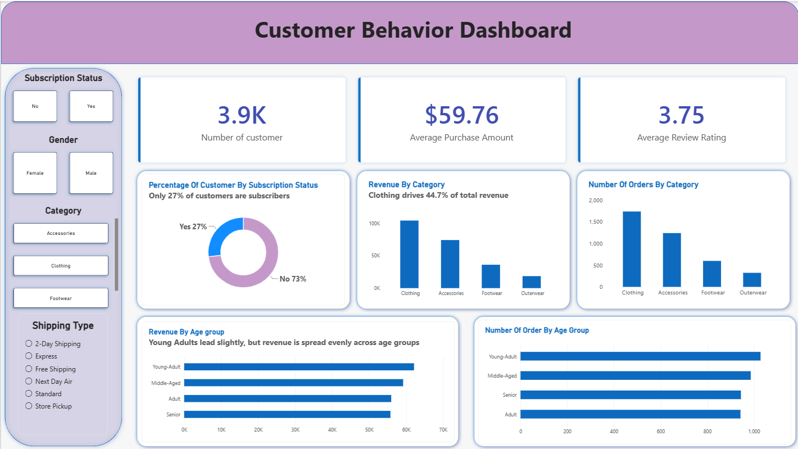
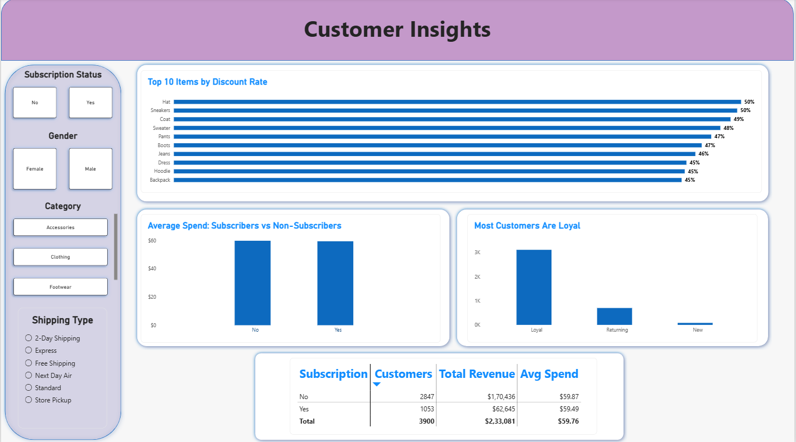

# Customer Behavior Analysis | Python, SQL Server, Power BI
An end-to-end analysis of retail customer behavior: cleaning data in Python, storing it in SQL Server, answering business questions with SQL, and presenting the findings in an interactive two-page Power BI dashboard.

## Business Problem
A retail business wants to understand who its customers are, what drives revenue, and whether subscriptions and discounts actually change how much people spend.This project turns raw customer records into insights the business can act on.

Questions answered:
- Which product categories and customer groups drive the most revenue?
- Do subscribers spend more than non-subscribers?
- Which items rely most heavily on discounts?
- How loyal is the customer base?

## Dataset
- 3,900 customer records, each with demographics, purchase details, review rating, subscription status, discount usage, shipping type, and purchase history
- Total revenue analyzed: $233,081
- Source: Customer Shopping Behavior dataset (Kaggle)

## Tools Used

| Stage | Tools |
|---|---|
| Data cleaning and feature engineering | Python (pandas) |
| Database | SQL Server (loaded with SQLAlchemy + pyodbc) |
| Analysis | SQL (CTEs, window functions, subqueries, CASE) |
| Visualization | Power BI (DAX measures, slicers, 2-page dashboard) |

## Project Workflow

1. Data Cleaning (Python)
- Filled missing **review ratings with the median of each product category**, which is more accurate than using one global average
- Standardized column names (lowercase, underscores)
- Engineered new features:
  - `age_group`: four quartile-based age segments
  - `purchase_frequency_days`: converted text frequencies (Weekly, Monthly, etc.) into numbers of days
- Checked for redundancy between `discount_applied` and `promo_code_used`, and dropped the duplicate column
- Exported the cleaned file and loaded it into SQL Server using SQLAlchemy

2. Analysis (SQL Server)
Ten queries covering revenue by gender, high-spending discount users, product ratings, shipping comparison, subscriber behavior, discount rate by item, customer segmentation (New / Returning / Loyal), top 3 items per category (window function), repeat buyers, and revenue by age group. 

3. Dashboard (Power BI)
A two-page interactive dashboard with slicers for subscription status, gender, category, and shipping type.

## Dashboard Preview

###  Page 1: Overview


### Page 2: Customer Insights

## Key Insights

1. Clothing drives the most revenue. Clothing accounts for 44.7% of total revenue, and together with Accessories (31.8%) it makes up about 76.5%. Footwear (15.5%) and Outerwear (7.9%) contribute much less.

2. Subscribers do not spend more than non-subscribers. Only 27% of customers (1,053) are subscribers, and they generate 26.9% of revenue. Their average spend is $59.49, compared with $59.87 for non-subscribers, which is essentially no difference.

3. Revenue is spread evenly across age groups. No single age group dominates, with Young Adults leading only slightly.

4. The customer base is mostly loyal.  Roughly four in five customers fall into the "Loyal" segment (more than 10 previous purchases), while very few are new customers.

5. Discounts are heavily used on certain items. Hats, Sneakers, Coats, and Sweaters have the highest discount rates, with discounts applied on close to half of their purchases.


## Recommendations
- Review the subscription program. It attracts only 27% of customers and does not increase spending. Adding stronger benefits (exclusive products, free shipping, early access) could make it worth joining.
- Prioritize Clothing and Accessories in inventory and marketing, since they bring in over three-quarters of revenue.
- Check whether heavy discounting is necessary on the items with the highest discount rates. If customers would buy at full price, margin is being lost.
- Build acquisition campaigns. With few new customers coming in, growth depends on attracting first-time buyers, not only retaining existing ones.

## Files in This Repository

- `customer_shopping_analysis_git.py`: data cleaning and loading into SQL Server
- `customer_behavior_analysis.sql`: the 10 SQL analysis queries
- `Customer_Behavior_Dashboard.pbix`: Power BI dashboard
- `customer_shopping_behavior.csv`: raw dataset
- `page1_overview.png`, `page2_customer_insights.png`: dashboard screenshots

## How to Run

1. Clone the repo
   ```bash
   git clone https://github.com/<your-username>/customer_behavior_analysis.git
   cd customer_behavior_analysis
   ```
2. Update the SQL Server connection string** in `customer_shopping_analysis_git.py` with your own server name (the ODBC Driver 17 for SQL Server  must be installed).
3. Run the Python script** to clean the data and load it into SQL Server
   ```bash
   python customer_shopping_analysis_git.py
   ```
4. Run the queries in `customer_behavior_analysis.sql` using SQL Server Management Studio.
5. Open the dashboard: open `Customer_Behavior_Dashboard.pbix` in Power BI Desktop and update the data source to your server.

## Limitations and Next Steps
- The dataset has one row per customer and no purchase dates, so time-based analysis (trends, seasonality, retention) is not possible.
- Age groups are quartile-based rather than fixed business-defined ranges.
- Planned improvement: add an automated reporting step that sends key metrics to an LLM API and generates a plain-English weekly summary of the findings.

## About Me
**[Tisha Parmar]** | Aspiring Data Analyst\
Skills: Python, SQL, Power BI, Excel
